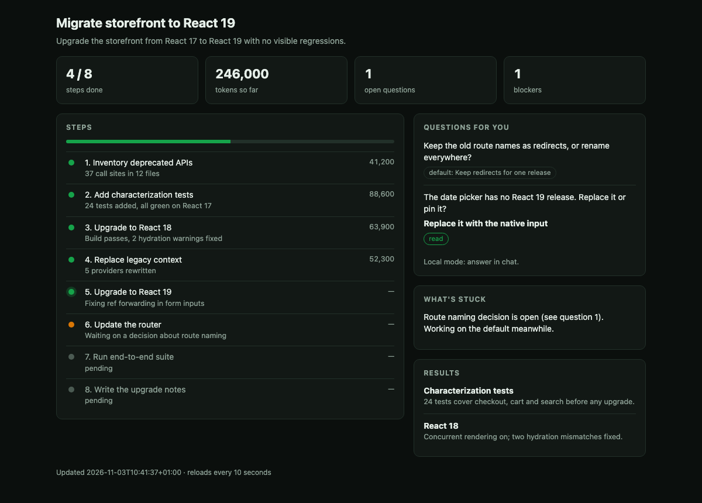
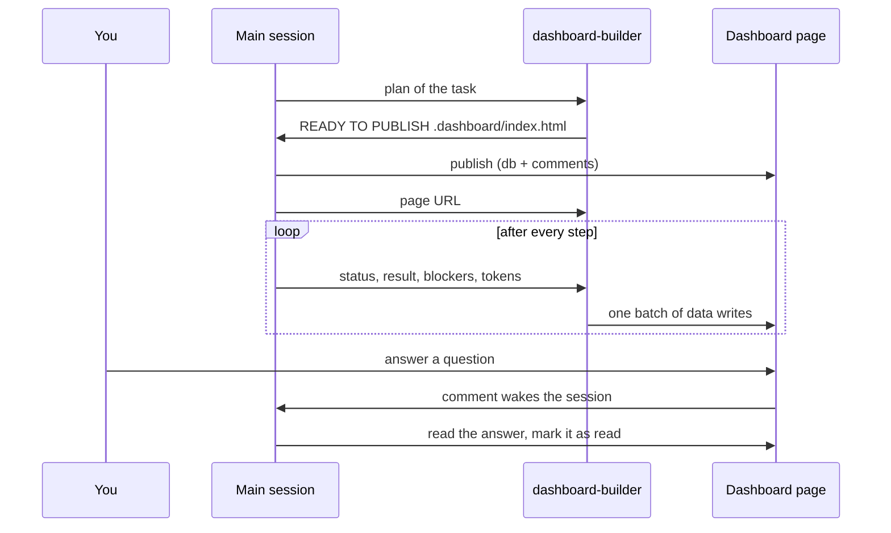

# Live dashboard for long Claude Code tasks

A Claude Code subagent that keeps one live progress page for a long task, and the hook that fences that subagent in.

When an agent works for an hour, the terminal scrollback stops being a status report. This gives you a page instead: which step is running, what is stuck, what each step cost in tokens, and the questions the agent has for you — each with a default it keeps working on until you answer.



The screenshot is the demo in [`examples/demo`](examples/demo), built from made-up data.

## What is in the repository

| Path | What it is |
| --- | --- |
| [`agents/dashboard-builder.md`](agents/dashboard-builder.md) | The subagent. It builds the page once, then only writes data. |
| [`hooks/dashboard-builder-guard.mjs`](hooks/dashboard-builder-guard.mjs) | A `PreToolUse` hook that limits what the subagent can touch. |
| [`snippets/CLAUDE.md`](snippets/CLAUDE.md) | The rule for your main session: when to start a dashboard and how to talk to it. |
| [`examples/demo`](examples/demo) | A local dashboard you can open in a browser right now. |
| [`test/guard.test.mjs`](test/guard.test.mjs) | Tests for the hook. |

## How it works



Three decisions shape the design.

**The main session publishes, the subagent never does.** Only the session that published the page is woken by comments on it. If the subagent published, your answers would go nowhere.

**Markup is written once; after that only data changes.** The page subscribes to its database and re-renders. An update is one batch of writes, not a rebuilt page, so it is cheap and cannot break the layout mid-task.

**Questions carry a default and the agent keeps working on it.** You are not a blocker. If you answer later, or change your answer after the agent has read it, the page shows that state (`not read yet`, `read`, `changed`) and the session rolls back what it did for the old answer before applying the new one. This applies to reversible decisions only: push, publish and delete still wait for an explicit yes.

## What the hook allows

The subagent has broad tools (`Write`, `Edit`, `Bash`, `Artifact`). The hook narrows them to what a dashboard needs.

| Tool | Allowed | Denied |
| --- | --- | --- |
| `Write`, `Edit` | Files inside `.dashboard/` and the agent's memory directory | Everything else, including paths that reach outside through a symlink |
| `.dashboard/artifact.json` | Reading | Writing. The main session owns it, so the subagent cannot point itself at another page |
| `Bash` | Exactly `date -Iseconds` | Any other command |
| `Artifact` | Reading or opening its own dashboard | Publishing, deleting, any other page |
| `ArtifactData` | The URL stored in `artifact.json` | Any other URL, files outside `.dashboard/` |
| `Read`, `ToolSearch` | Yes | |
| Any other tool | | Denied |

The hook never approves a call on its own. A silent exit means "no opinion", so your normal permission rules still apply. Unreadable input blocks the call.

## Install

Requires Node.js 20 or newer for the hook.

```bash
git clone https://github.com/Diizer/claude-code-live-dashboard.git
```

```bash
mkdir -p ~/.claude/agents ~/.claude/hooks && cp claude-code-live-dashboard/agents/dashboard-builder.md ~/.claude/agents/ && cp claude-code-live-dashboard/hooks/dashboard-builder-guard.mjs ~/.claude/hooks/
```

Then add the contents of [`snippets/CLAUDE.md`](snippets/CLAUDE.md) to your `~/.claude/CLAUDE.md`.

On the first run the subagent asks for a style (theme, density, accent color, page language) and saves it to its memory. Later runs reuse it.

## Two modes

**Live mode** publishes the page as a private claude.ai artifact with a database and comments. You answer questions on the page and the session picks them up. It needs the `Artifact` and `ArtifactData` tools in your Claude Code session. I built and used it in the Claude desktop app; I have not checked which plans or clients expose those tools.

**Local mode** is the fallback when publishing is not available. The subagent writes `.dashboard/index.html` once and then updates `.dashboard/data.js`; the page reloads itself every 10 seconds. Questions are shown read-only and you answer in chat. The demo runs in this mode:

```bash
open claude-code-live-dashboard/examples/demo/index.html
```

## Token cost

The subagent is set up to stay small: `effort: medium`, `omitClaudeMd: true` so it does not load your global instructions, only the tools and skills it needs, and its own memory for style and lessons learned.

The `tokens` column shows what the main session reports for each step. The subagent never estimates a number; if none is reported, the cell stays empty.

## Tests

```bash
npm test
```

The tests run the hook as a child process against a temporary project and cover the allowed paths and every denial in the table above, including the symlink cases.

## Limits

- One dashboard per working directory. A second long task in the same directory reuses `.dashboard/`.
- The page shows what the main session tells the subagent. A step the session forgets to report stays in its old state.
- Frontmatter fields such as `memory`, `omitClaudeMd` and `hooks` depend on your Claude Code version.

## License

MIT
